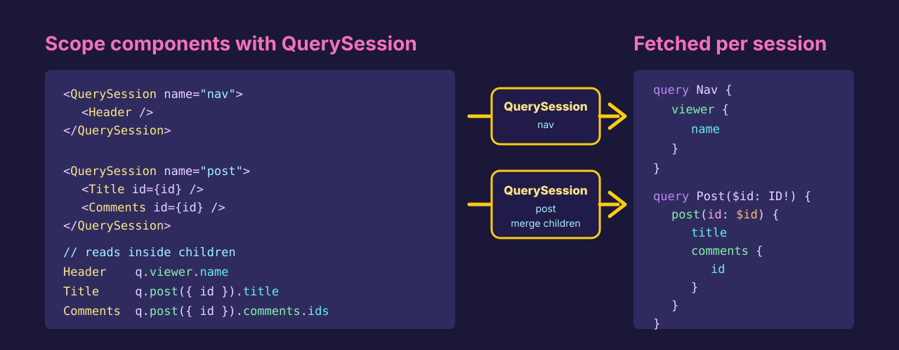

# GQLens [](https://www.npmjs.com/package/@gqlens/core) [](https://github.com/PluxelJS/GQLens/actions/workflows/ci.yml) [](./LICENSE)

<p align="center">
  
</p>

GQLens is a demand-first GraphQL client for React and Solid. Generated accessors feed `QuerySession` scopes; each scope plans, caches, and fetches its own selection.

```sh
vp add @gqlens/core @gqlens/react
vp add -D @gqlens/vite graphql
```

Use `@gqlens/solid` instead of `@gqlens/react` for Solid.

Read next:

- [Vite codegen best practices](./docs/Vite-Codegen最佳实践.md)
- [Yoga + Vite example](./examples/yoga-vite-codegen/README.md)
- [API syntax spec](./docs/规范-API语法.md)
- [Framework adapters](./docs/06-框架适配.md)
- [Schema design guide](./docs/服务端-Schema设计指南.md)

## Development

```sh
mise trust
mise install
vp install --frozen-lockfile
vp run verify
vp run build
```

## Release

GQLens keeps all `@gqlens/*` packages on one `major.minor` release line.
Patch releases only need to include the packages that changed; minor and major
releases should include every public package so they converge on the same next
release line.

```sh
vp run changeset
vp run release:version
vp run release:publish
```

开发工具版本由 `mise.toml` 固定；构建、测试、类型、lint 和格式入口统一为 `vp`，任务图与缓存位于 `vite.config.ts`。`vp run hooks:install` 显式安装 hk 提交检查；普通检查用 `vp check`，完整门禁用 `vp run verify`。`examples/yoga-vite-codegen` 属于同一工作区并共享 lockfile；其 `example` catalog 保留 Yoga 所需的 GraphQL 16，示例服务由根 `pitchfork.toml` 管理。

根 lint 和格式规则分别维护在 `oxlint.config.ts`、`oxfmt.config.ts`，由 `vite.config.ts` 显式引用；执行入口仍为 `vp check`。

同名 checkout 同时运行时，在各自忽略的 `pitchfork.local.toml` 中指定不同的 `namespace`，避免服务身份冲突。

mise 安装在 Nix 等非标准位置时，将 `command -v mise` 返回的绝对路径写入本仓库 Git 根目录下忽略的
`pitchfork.local.toml`，让 Pitchfork 加载工具和环境：

```toml
[settings.general]
mise_bin = "/absolute/path/to/mise"
```

## Dependency catalogs

Development and runtime dependency versions are managed with pncat in the root `pnpm-workspace.yaml`. Run `vp run catalog:migrate` to migrate declarations and `pnpm install` to update the lockfile. `vp run catalog:detect` reports migration candidates; upstream detection does not fail the command when candidates exist. Published peer ranges remain compatibility declarations. Packages and the Yoga/Vite example share this workspace and lockfile. Each package keeps its direct dependency declarations. When these packages are explicit members of a parent workspace, that workspace supplies the same named catalogs and selects their installed versions.
